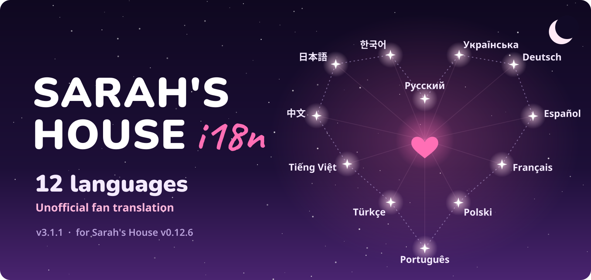

<p align="center">
  
</p>

<p align="center">
  <a href="https://github.com/elofaster/sarahs-house-i18n/releases/latest"></a>
  &nbsp;
  <a href="https://discord.gg/FXsWMq9Rv7"></a>
</p>

<p align="center">
<b>English</b> &nbsp;✦&nbsp; <a href="docs/readme/README.ru.md">Русский</a> &nbsp;✦&nbsp; <a href="docs/readme/README.uk.md">Українська</a> &nbsp;✦&nbsp; <a href="docs/readme/README.de.md">Deutsch</a> &nbsp;✦&nbsp; <a href="docs/readme/README.es.md">Español</a> &nbsp;✦&nbsp; <a href="docs/readme/README.fr.md">Français</a> &nbsp;✦&nbsp; <a href="docs/readme/README.pl.md">Polski</a> &nbsp;✦&nbsp; <a href="docs/readme/README.pt.md">Português</a> &nbsp;✦&nbsp; <a href="docs/readme/README.tr.md">Türkçe</a> &nbsp;✦&nbsp; <a href="docs/readme/README.vi.md">Tiếng&nbsp;Việt</a> &nbsp;✦&nbsp; <a href="docs/readme/README.zh.md">中⁠文</a> &nbsp;✦&nbsp; <a href="docs/readme/README.ja.md">日⁠本⁠語</a> &nbsp;✦&nbsp; <a href="docs/readme/README.ko.md">한⁠국⁠어</a>
</p>

<br>


<p align="center"><sub>The game is not included. You need your own copy. <a href="https://store.steampowered.com/app/4712060/Sarahs_House" title="Buy on Steam">Steam</a> · <a href="https://ace-stud.itch.io/sarahs-house" title="Get it on itch.io">itch.io</a></sub></p>

## ✦ Install

1. Download `SarahsHouse-i18n-v3.1.1.zip` from the [releases page](https://github.com/elofaster/sarahs-house-i18n/releases/latest).
2. Unzip it into the game folder, the one with `SarahsHouse.exe` in it. Merge, do not nest: the folders from the archive land next to the exe.
3. Launch the game. The first start takes a minute or two longer than usual while BepInEx sets itself up for your copy, then the language picker opens on its own.

After that the folder looks like this:

```text
SarahsHouse/
├─ SarahsHouse.exe
├─ winhttp.dll
├─ doorstop_config.ini
├─ dotnet/
└─ BepInEx/
    └─ plugins/
        └─ SarahsHouseI18n/
```

`winhttp.dll`, `doorstop_config.ini`, `dotnet/` and `BepInEx/` all come from the archive; the mod itself is the last folder.

<details>
<summary><b>Already running BepInEx 6 IL2CPP?</b></summary>

Then you only need the mod itself: copy `BepInEx/plugins/SarahsHouseI18n/` from the archive into your own `BepInEx/plugins/` and start the game. Nothing else from the archive is required, and the language you pick is remembered per install.

</details>

<details>
<summary><b>Changing the language later</b></summary>

Press <kbd>F10</kbd> in the main menu. The picker opens over the scene with the current language in the middle of the wheel, and confirming swaps the text right away.

</details>

## ✦ The picker


Mouse, arrow keys or a gamepad. <kbd>Enter</kbd> confirms, <kbd>F10</kbd> brings the picker back later.

## ✦ If something went wrong

<details>
<summary><b>The first launch takes forever</b></summary>

That one is expected. BepInEx generates assemblies for your copy of the game the first time it runs, a minute or two, once. Every launch after that is normal speed.
</details>

<details>
<summary><b>My antivirus flags <code>winhttp.dll</code></b></summary>

That file is the BepInEx loader and it is standard for Unity mods everywhere. Restore it from quarantine and add the game folder to your exclusions.
</details>

<details>
<summary><b>Some lines went back to English after a game update</b></summary>

New and changed lines are not translated yet, so they fall back to English and the game keeps running normally. The next mod release closes the gap.
</details>

<details>
<summary><b>How do I remove the mod?</b></summary>

Delete `BepInEx/plugins/SarahsHouseI18n`. To take BepInEx out as well, also delete `winhttp.dll`, `doorstop_config.ini` and `dotnet/`. The game goes back to how it shipped.
</details>

---

<p align="center"><sub>
v3.1.1 · Sarah's House v0.12.6 · <a href="https://github.com/BepInEx/BepInEx">BepInEx</a> 6 IL2CPP<br>
Fonts are bundled under SIL OFL and Apache 2.0. Built on <a href="https://github.com/BepInEx/BepInEx">BepInEx</a>. Unofficial fan translation, not affiliated with AceStudio.
</sub></p>
