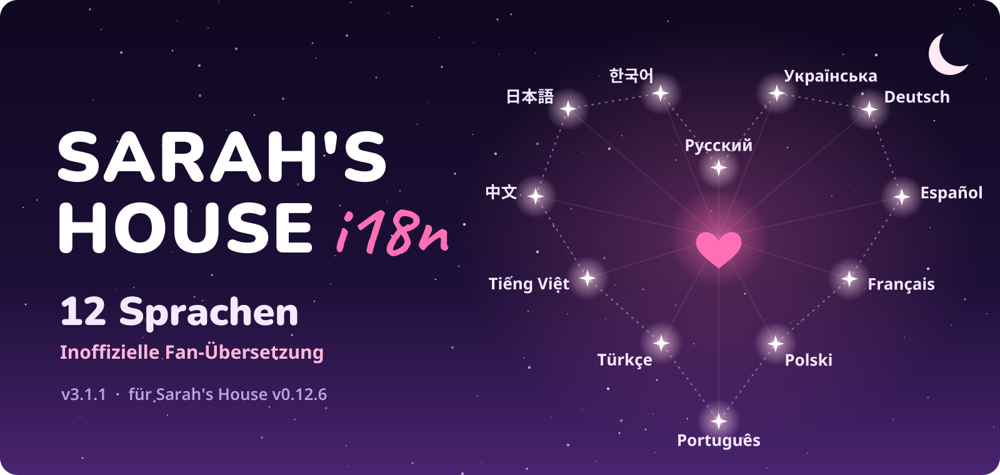
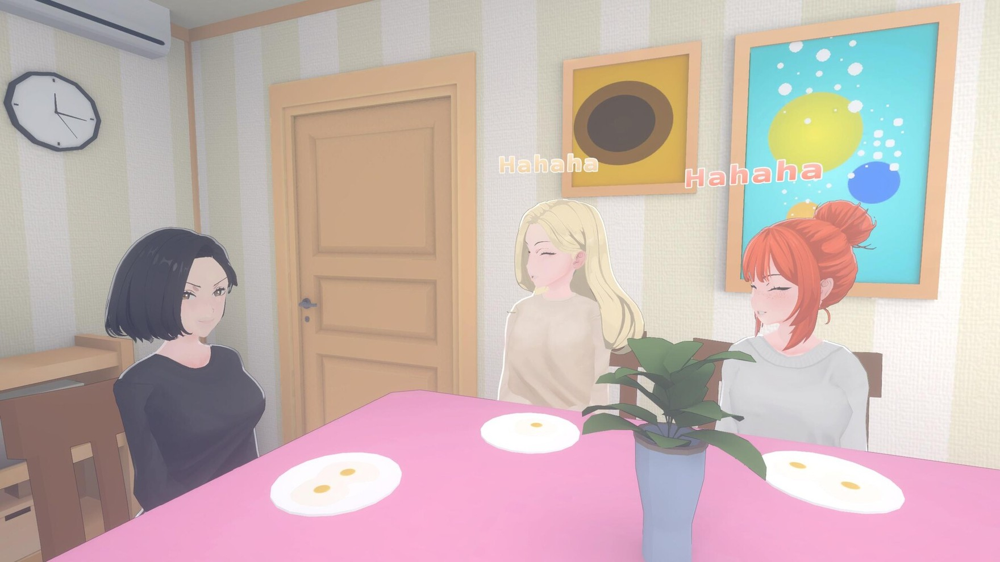
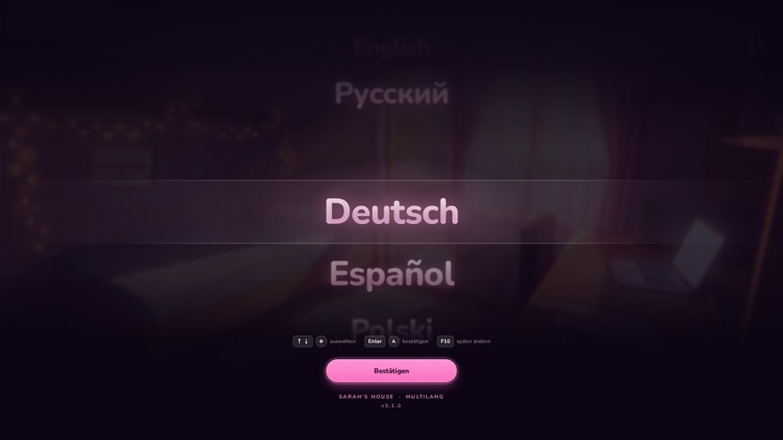

<p align="center">
  
</p>

<p align="center">
  <a href="https://github.com/elofaster/sarahs-house-i18n/releases/latest"></a>
  &nbsp;
  <a href="https://discord.gg/FXsWMq9Rv7"></a>
</p>

<p align="center">
<a href="../../README.md">English</a> &nbsp;✦&nbsp; <a href="README.ru.md">Русский</a> &nbsp;✦&nbsp; <a href="README.uk.md">Українська</a> &nbsp;✦&nbsp; <b>Deutsch</b> &nbsp;✦&nbsp; <a href="README.es.md">Español</a> &nbsp;✦&nbsp; <a href="README.fr.md">Français</a> &nbsp;✦&nbsp; <a href="README.pl.md">Polski</a> &nbsp;✦&nbsp; <a href="README.pt.md">Português</a> &nbsp;✦&nbsp; <a href="README.tr.md">Türkçe</a> &nbsp;✦&nbsp; <a href="README.vi.md">Tiếng&nbsp;Việt</a> &nbsp;✦&nbsp; <a href="README.zh.md">中⁠文</a> &nbsp;✦&nbsp; <a href="README.ja.md">日⁠本⁠語</a> &nbsp;✦&nbsp; <a href="README.ko.md">한⁠국⁠어</a>
</p>

<br>



<p align="center"><sub>Das Spiel ist nicht enthalten. Du brauchst deine eigene Kopie. <a href="https://store.steampowered.com/app/4712060/Sarahs_House" title="Auf Steam kaufen">Steam</a> · <a href="https://ace-stud.itch.io/sarahs-house" title="Auf itch.io holen">itch.io</a></sub></p>

## ✦ Installation

1. Lade `SarahsHouse-i18n-v3.1.1.zip` von der [Release-Seite](https://github.com/elofaster/sarahs-house-i18n/releases/latest) herunter.
2. Entpacke das Archiv in den Spielordner, den mit `SarahsHouse.exe`. Zusammenführen, nicht verschachteln: die Ordner aus dem Archiv landen neben der exe.
3. Starte das Spiel. Der erste Start dauert ein bis zwei Minuten länger, weil BepInEx sich einmal für deine Kopie einrichtet, danach öffnet sich die Sprachauswahl von selbst.

Danach sieht der Ordner so aus:

```text
SarahsHouse/
├─ SarahsHouse.exe
├─ winhttp.dll
├─ doorstop_config.ini
├─ dotnet/
└─ BepInEx/
    └─ plugins/
        └─ SarahsHouseI18n/
```

`winhttp.dll`, `doorstop_config.ini`, `dotnet/` und `BepInEx/` kommen alle aus dem Archiv; der Mod selbst ist der letzte Ordner.

<details>
<summary><b>BepInEx 6 IL2CPP läuft schon?</b></summary>

Dann brauchst du nur den Mod: kopiere `BepInEx/plugins/SarahsHouseI18n/` aus dem Archiv in dein eigenes `BepInEx/plugins/` und starte das Spiel. Sonst ist nichts aus dem Archiv nötig, und die gewählte Sprache bleibt pro Installation gespeichert.

</details>

<details>
<summary><b>Sprache später ändern</b></summary>

Drücke im Hauptmenü <kbd>F10</kbd>. Die Auswahl öffnet sich über der Szene, die aktuelle Sprache steht in der Mitte des Rads, und mit dem Bestätigen wird der Text sofort getauscht.

</details>

## ✦ Die Sprachauswahl



Maus, Pfeiltasten oder Gamepad. <kbd>Enter</kbd> bestätigt, <kbd>F10</kbd> holt die Auswahl später zurück.

## ✦ Wenn etwas schiefgelaufen ist

<details>
<summary><b>Der erste Start dauert ewig</b></summary>

Das ist normal. BepInEx erzeugt beim ersten Start Assemblies für deine Kopie des Spiels, ein bis zwei Minuten, einmalig. Jeder weitere Start läuft normal schnell.
</details>

<details>
<summary><b>Mein Antivirus meldet <code>winhttp.dll</code></b></summary>

Die Datei ist der BepInEx-Loader und bei Unity-Mods überall Standard. Stelle sie aus der Quarantäne wieder her und nimm den Spielordner in die Ausnahmen auf.
</details>

<details>
<summary><b>Nach einem Spiel-Update sind einige Zeilen wieder englisch</b></summary>

Neue und geänderte Zeilen sind noch nicht übersetzt, sie fallen auf Englisch zurück und das Spiel läuft normal weiter. Das nächste Mod-Release schließt die Lücke.
</details>

<details>
<summary><b>Wie entferne ich den Mod?</b></summary>

Lösche `BepInEx/plugins/SarahsHouseI18n`. Wenn BepInEx auch weg soll, lösche zusätzlich `winhttp.dll`, `doorstop_config.ini` und `dotnet/`. Das Spiel ist dann wieder wie ausgeliefert.
</details>

---

<p align="center"><sub>
v3.1.1 · Sarah's House v0.12.6 · <a href="https://github.com/BepInEx/BepInEx">BepInEx</a> 6 IL2CPP<br>
Die Schriften liegen unter SIL OFL und Apache 2.0 bei. Läuft auf BepInEx. Inoffizielle Fan-Übersetzung, nicht mit AceStudio verbunden.
</sub></p>
