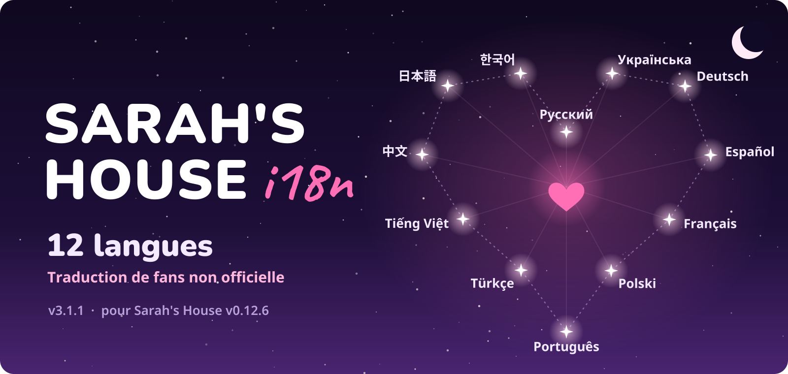

<p align="center">
  
</p>

<p align="center">
  <a href="https://github.com/elofaster/sarahs-house-i18n/releases/latest"></a>
  &nbsp;
  <a href="https://discord.gg/FXsWMq9Rv7"></a>
</p>

<p align="center">
<a href="../../README.md">English</a> &nbsp;✦&nbsp; <a href="README.ru.md">Русский</a> &nbsp;✦&nbsp; <a href="README.uk.md">Українська</a> &nbsp;✦&nbsp; <a href="README.de.md">Deutsch</a> &nbsp;✦&nbsp; <a href="README.es.md">Español</a> &nbsp;✦&nbsp; <b>Français</b> &nbsp;✦&nbsp; <a href="README.pl.md">Polski</a> &nbsp;✦&nbsp; <a href="README.pt.md">Português</a> &nbsp;✦&nbsp; <a href="README.tr.md">Türkçe</a> &nbsp;✦&nbsp; <a href="README.vi.md">Tiếng&nbsp;Việt</a> &nbsp;✦&nbsp; <a href="README.zh.md">中⁠文</a> &nbsp;✦&nbsp; <a href="README.ja.md">日⁠本⁠語</a> &nbsp;✦&nbsp; <a href="README.ko.md">한⁠국⁠어</a>
</p>

<br>


<p align="center"><sub>Le jeu n'est pas inclus. Il vous faut votre propre copie. <a href="https://store.steampowered.com/app/4712060/Sarahs_House" title="Acheter sur Steam">Steam</a> · <a href="https://ace-stud.itch.io/sarahs-house" title="Le prendre sur itch.io">itch.io</a></sub></p>

## ✦ Installation

1. Téléchargez `SarahsHouse-i18n-v3.1.1.zip` depuis la [page des versions](https://github.com/elofaster/sarahs-house-i18n/releases/latest).
2. Décompressez l'archive dans le dossier du jeu, celui où se trouve `SarahsHouse.exe`. Fusionnez, sans imbriquer : les dossiers de l'archive arrivent à côté de l'exe.
3. Lancez le jeu. Le premier démarrage prend une ou deux minutes de plus, le temps que BepInEx se configure pour votre copie, ensuite le sélecteur de langue s'ouvre tout seul.

Ensuite, le dossier ressemble à ceci :

```text
SarahsHouse/
├─ SarahsHouse.exe
├─ winhttp.dll
├─ doorstop_config.ini
├─ dotnet/
└─ BepInEx/
    └─ plugins/
        └─ SarahsHouseI18n/
```

`winhttp.dll`, `doorstop_config.ini`, `dotnet/` et `BepInEx/` viennent tous de l'archive ; le mod est le dernier dossier.

<details>
<summary><b>Vous avez déjà BepInEx 6 IL2CPP ?</b></summary>

Il vous faut alors seulement le mod : copiez `BepInEx/plugins/SarahsHouseI18n/` de l'archive dans votre propre `BepInEx/plugins/` et lancez le jeu. Rien d'autre n'est nécessaire, et la langue choisie est mémorisée pour chaque installation.

</details>

<details>
<summary><b>Changer de langue plus tard</b></summary>

Appuyez sur <kbd>F10</kbd> dans le menu principal. Le sélecteur s'ouvre sur la scène, la langue actuelle au milieu de la roue, et la validation change le texte immédiatement.

</details>

## ✦ Le sélecteur


Souris, flèches ou manette. <kbd>Entrée</kbd> valide, <kbd>F10</kbd> ramène le sélecteur plus tard.

## ✦ Si quelque chose a raté

<details>
<summary><b>Le premier démarrage est interminable</b></summary>

C'est normal. BepInEx génère les assemblys pour votre copie du jeu au premier lancement, une ou deux minutes, une seule fois. Les lancements suivants sont à vitesse normale.
</details>

<details>
<summary><b>Mon antivirus signale <code>winhttp.dll</code></b></summary>

Ce fichier est le chargeur de BepInEx, standard pour les mods Unity. Restaurez-le depuis la quarantaine et ajoutez le dossier du jeu aux exclusions.
</details>

<details>
<summary><b>Certaines lignes repassent en anglais après une mise à jour du jeu</b></summary>

Les lignes nouvelles et modifiées ne sont pas encore traduites : elles s'affichent en anglais et le jeu continue normalement. La prochaine version du mod comble le manque.
</details>

<details>
<summary><b>Comment retirer le mod ?</b></summary>

Supprimez `BepInEx/plugins/SarahsHouseI18n`. Pour retirer aussi BepInEx, supprimez également `winhttp.dll`, `doorstop_config.ini` et `dotnet/`. Le jeu redevient comme à l'origine.
</details>

---

<p align="center"><sub>
v3.1.1 · Sarah's House v0.12.6 · <a href="https://github.com/BepInEx/BepInEx">BepInEx</a> 6 IL2CPP<br>
Les polices sont fournies sous SIL OFL et Apache 2.0. Fonctionne sur BepInEx. Traduction de fans non officielle, sans lien avec AceStudio.
</sub></p>
