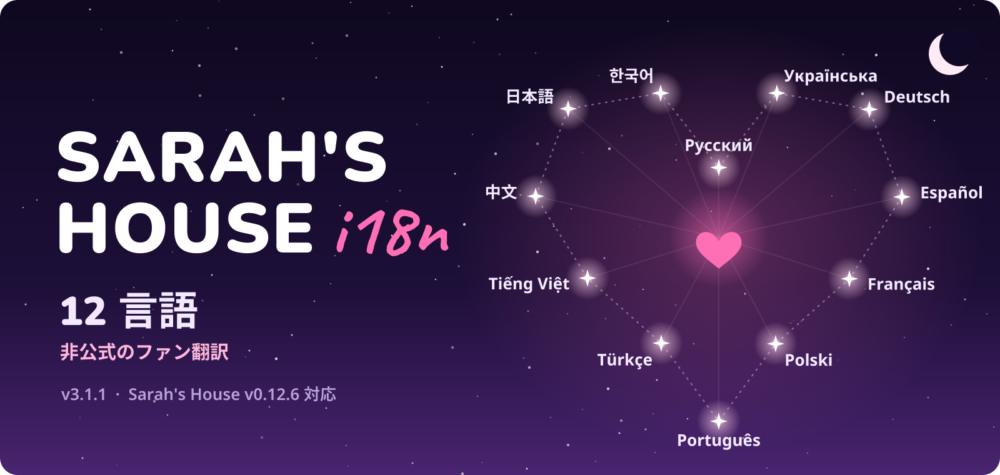

<p align="center">
  
</p>

<p align="center">
  <a href="https://github.com/elofaster/sarahs-house-i18n/releases/latest"></a>
  &nbsp;
  <a href="https://discord.gg/FXsWMq9Rv7"></a>
</p>

<p align="center">
<a href="../../README.md">English</a> &nbsp;✦&nbsp; <a href="README.ru.md">Русский</a> &nbsp;✦&nbsp; <a href="README.uk.md">Українська</a> &nbsp;✦&nbsp; <a href="README.de.md">Deutsch</a> &nbsp;✦&nbsp; <a href="README.es.md">Español</a> &nbsp;✦&nbsp; <a href="README.fr.md">Français</a> &nbsp;✦&nbsp; <a href="README.pl.md">Polski</a> &nbsp;✦&nbsp; <a href="README.pt.md">Português</a> &nbsp;✦&nbsp; <a href="README.tr.md">Türkçe</a> &nbsp;✦&nbsp; <a href="README.vi.md">Tiếng&nbsp;Việt</a> &nbsp;✦&nbsp; <a href="README.zh.md">中⁠文</a> &nbsp;✦&nbsp; <b>日⁠本⁠語</b> &nbsp;✦&nbsp; <a href="README.ko.md">한⁠국⁠어</a>
</p>

<br>


<p align="center"><sub>ゲーム本体は含まれていません。ご自分のコピーが必要です。 <a href="https://store.steampowered.com/app/4712060/Sarahs_House" title="Steam で購入">Steam</a> · <a href="https://ace-stud.itch.io/sarahs-house" title="itch.io で入手">itch.io</a></sub></p>

## ✦ インストール

1. [リリースページ](https://github.com/elofaster/sarahs-house-i18n/releases/latest)から `SarahsHouse-i18n-v3.1.1.zip` をダウンロードします。
2. `SarahsHouse.exe` があるゲームフォルダに解凍します。フォルダを入れ子にせず、そのまま統合してください。圧縮ファイル内のフォルダが exe の隣に並びます。
3. ゲームを起動します。初回だけ 1〜2 分長くなります（BepInEx があなたのコピー用に一度だけ設定します）。そのあと言語選択画面が自動で開きます。

終わるとフォルダはこうなります:

```text
SarahsHouse/
├─ SarahsHouse.exe
├─ winhttp.dll
├─ doorstop_config.ini
├─ dotnet/
└─ BepInEx/
    └─ plugins/
        └─ SarahsHouseI18n/
```

`winhttp.dll`、`doorstop_config.ini`、`dotnet/`、`BepInEx/` はすべて圧縮ファイルのものです。Mod 本体は最後のフォルダです。

<details>
<summary><b>BepInEx 6 IL2CPP をすでに使っていますか？</b></summary>

その場合は Mod だけで十分です。圧縮ファイル内の `BepInEx/plugins/SarahsHouseI18n/` を自分の `BepInEx/plugins/` にコピーしてゲームを起動してください。ほかのファイルは不要で、選んだ言語はインストールごとに記憶されます。

</details>

<details>
<summary><b>あとから言語を変える</b></summary>

メインメニューで <kbd>F10</kbd> を押します。現在の言語が輪の中央にある状態で選択画面がシーンの上に開き、決定するとすぐにテキストが切り替わります。

</details>

## ✦ 言語選択


マウス、方向キー、ゲームパッドに対応。<kbd>Enter</kbd> で決定、<kbd>F10</kbd> でいつでも呼び出せます。

## ✦ うまくいかないとき

<details>
<summary><b>初回起動がとても長い</b></summary>

これは正常です。初回だけ BepInEx がゲームのコピー用にアセンブリを生成するため、1〜2 分かかります。2 回目以降は通常の速さです。
</details>

<details>
<summary><b>ウイルス対策が <code>winhttp.dll</code> を検出する</b></summary>

このファイルは BepInEx のローダーで、Unity の Mod では一般的なものです。隔離から復元し、ゲームフォルダを除外に追加してください。
</details>

<details>
<summary><b>ゲーム更新後、一部の文章が英語に戻った</b></summary>

新しく変わった行はまだ未訳のため英語で表示されますが、ゲームは普通に動きます。次の Mod の更新で埋まります。
</details>

<details>
<summary><b>Mod を削除するには？</b></summary>

`BepInEx/plugins/SarahsHouseI18n` を削除します。BepInEx も消すなら `winhttp.dll`、`doorstop_config.ini`、`dotnet/` も削除してください。ゲームは元の状態に戻ります。
</details>

---

<p align="center"><sub>
v3.1.1 · Sarah's House v0.12.6 · <a href="https://github.com/BepInEx/BepInEx">BepInEx</a> 6 IL2CPP<br>
フォントは SIL OFL と Apache 2.0 で同梱しています。BepInEx 上で動作します。非公式のファン翻訳で、AceStudio とは関係ありません。
</sub></p>
