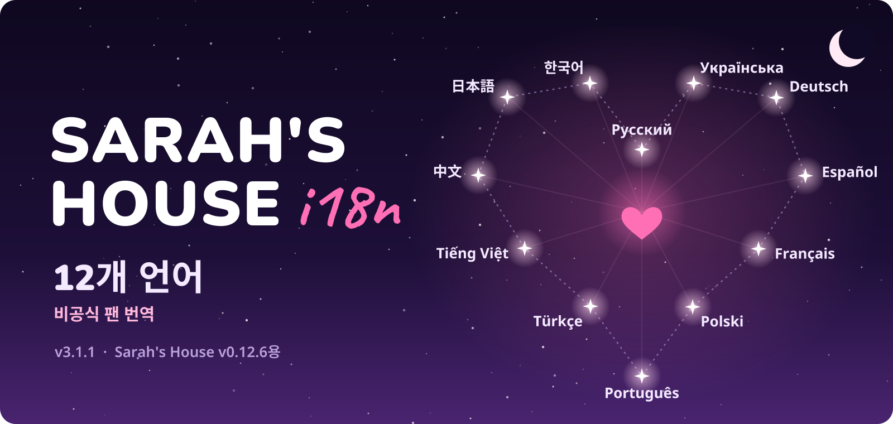

<p align="center">
  
</p>

<p align="center">
  <a href="https://github.com/elofaster/sarahs-house-i18n/releases/latest"></a>
  &nbsp;
  <a href="https://discord.gg/FXsWMq9Rv7"></a>
</p>

<p align="center">
<a href="../../README.md">English</a> &nbsp;✦&nbsp; <a href="README.ru.md">Русский</a> &nbsp;✦&nbsp; <a href="README.uk.md">Українська</a> &nbsp;✦&nbsp; <a href="README.de.md">Deutsch</a> &nbsp;✦&nbsp; <a href="README.es.md">Español</a> &nbsp;✦&nbsp; <a href="README.fr.md">Français</a> &nbsp;✦&nbsp; <a href="README.pl.md">Polski</a> &nbsp;✦&nbsp; <a href="README.pt.md">Português</a> &nbsp;✦&nbsp; <a href="README.tr.md">Türkçe</a> &nbsp;✦&nbsp; <a href="README.vi.md">Tiếng&nbsp;Việt</a> &nbsp;✦&nbsp; <a href="README.zh.md">中⁠文</a> &nbsp;✦&nbsp; <a href="README.ja.md">日⁠本⁠語</a> &nbsp;✦&nbsp; <b>한⁠국⁠어</b>
</p>

<br>


<p align="center"><sub>게임 본편은 포함되어 있지 않습니다. 직접 준비한 게임이 필요합니다. <a href="https://store.steampowered.com/app/4712060/Sarahs_House" title="Steam에서 구매">Steam</a> · <a href="https://ace-stud.itch.io/sarahs-house" title="itch.io에서 받기">itch.io</a></sub></p>

## ✦ 설치

1. [릴리스 페이지](https://github.com/elofaster/sarahs-house-i18n/releases/latest)에서 `SarahsHouse-i18n-v3.1.1.zip`을 내려받습니다.
2. `SarahsHouse.exe`가 있는 게임 폴더에 압축을 풉니다. 폴더를 겹치지 말고 그대로 합치세요. 압축 파일 안의 폴더가 exe 옆에 놓입니다.
3. 게임을 실행합니다. 첫 실행만 1~2분 더 걸립니다(BepInEx가 여러분의 게임 사본에 맞춰 한 번 설정합니다). 그다음 언어 선택 화면이 저절로 열립니다.

그러면 폴더는 이렇게 됩니다:

```text
SarahsHouse/
├─ SarahsHouse.exe
├─ winhttp.dll
├─ doorstop_config.ini
├─ dotnet/
└─ BepInEx/
    └─ plugins/
        └─ SarahsHouseI18n/
```

`winhttp.dll`, `doorstop_config.ini`, `dotnet/`, `BepInEx/`는 모두 압축 파일에서 나온 것입니다. 모드 본체는 마지막 폴더입니다.

<details>
<summary><b>이미 BepInEx 6 IL2CPP를 쓰고 있나요?</b></summary>

그렇다면 모드만 있으면 됩니다. 압축 파일의 `BepInEx/plugins/SarahsHouseI18n/`을 자신의 `BepInEx/plugins/`로 복사하고 게임을 실행하세요. 압축 파일의 다른 파일은 필요 없고, 고른 언어는 설치마다 기억됩니다.

</details>

<details>
<summary><b>나중에 언어 바꾸기</b></summary>

메인 메뉴에서 <kbd>F10</kbd>을 누릅니다. 현재 언어가 바퀴 가운데에 있는 상태로 선택 화면이 장면 위에 열리고, 확인하면 텍스트가 바로 바뀝니다.

</details>

## ✦ 언어 선택


마우스, 방향키, 게임패드를 지원합니다. <kbd>Enter</kbd>로 확인하고 <kbd>F10</kbd>으로 다시 불러올 수 있습니다.

## ✦ 문제가 생겼다면

<details>
<summary><b>첫 실행이 끝나지 않을 만큼 오래 걸립니다</b></summary>

정상입니다. 첫 실행 때 BepInEx가 여러분의 게임 사본용 어셈블리를 만듭니다. 1~2분, 한 번뿐입니다. 다음부터는 평소 속도입니다.
</details>

<details>
<summary><b>백신이 <code>winhttp.dll</code>을 잡습니다</b></summary>

그 파일은 BepInEx 로더로, Unity 모드에서 흔히 쓰입니다. 격리에서 복원하고 게임 폴더를 예외에 추가하세요.
</details>

<details>
<summary><b>게임 업데이트 후 일부 문장이 영어로 돌아갔습니다</b></summary>

새로 생기거나 바뀐 줄은 아직 번역되지 않아 영어로 표시되며, 게임은 정상 동작합니다. 다음 모드 버전에서 채워집니다.
</details>

<details>
<summary><b>모드는 어떻게 지우나요?</b></summary>

`BepInEx/plugins/SarahsHouseI18n`을 삭제합니다. BepInEx까지 지우려면 `winhttp.dll`, `doorstop_config.ini`, `dotnet/`도 삭제하세요. 게임은 처음 상태로 돌아갑니다.
</details>

---

<p align="center"><sub>
v3.1.1 · Sarah's House v0.12.6 · <a href="https://github.com/BepInEx/BepInEx">BepInEx</a> 6 IL2CPP<br>
폰트는 SIL OFL과 Apache 2.0으로 함께 제공됩니다. BepInEx에서 동작합니다. 비공식 팬 번역이며 AceStudio와 무관합니다.
</sub></p>
