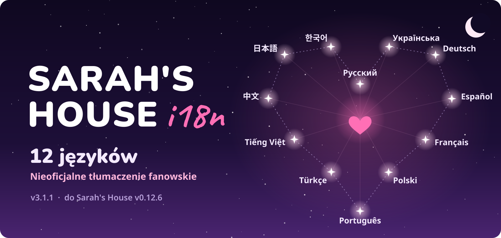

<p align="center">
  
</p>

<p align="center">
  <a href="https://github.com/elofaster/sarahs-house-i18n/releases/latest"></a>
  &nbsp;
  <a href="https://discord.gg/FXsWMq9Rv7"></a>
</p>

<p align="center">
<a href="../../README.md">English</a> &nbsp;✦&nbsp; <a href="README.ru.md">Русский</a> &nbsp;✦&nbsp; <a href="README.uk.md">Українська</a> &nbsp;✦&nbsp; <a href="README.de.md">Deutsch</a> &nbsp;✦&nbsp; <a href="README.es.md">Español</a> &nbsp;✦&nbsp; <a href="README.fr.md">Français</a> &nbsp;✦&nbsp; <b>Polski</b> &nbsp;✦&nbsp; <a href="README.pt.md">Português</a> &nbsp;✦&nbsp; <a href="README.tr.md">Türkçe</a> &nbsp;✦&nbsp; <a href="README.vi.md">Tiếng&nbsp;Việt</a> &nbsp;✦&nbsp; <a href="README.zh.md">中⁠文</a> &nbsp;✦&nbsp; <a href="README.ja.md">日⁠本⁠語</a> &nbsp;✦&nbsp; <a href="README.ko.md">한⁠국⁠어</a>
</p>

<br>


<p align="center"><sub>Gra nie jest dołączona. Potrzebujesz własnej kopii. <a href="https://store.steampowered.com/app/4712060/Sarahs_House" title="Kup na Steam">Steam</a> · <a href="https://ace-stud.itch.io/sarahs-house" title="Pobierz z itch.io">itch.io</a></sub></p>

## ✦ Instalacja

1. Pobierz `SarahsHouse-i18n-v3.1.1.zip` ze [strony wydań](https://github.com/elofaster/sarahs-house-i18n/releases/latest).
2. Rozpakuj archiwum do folderu gry, tego z plikiem `SarahsHouse.exe`. Scal, nie zagnieżdżaj: foldery z archiwum lądują obok exe.
3. Uruchom grę. Pierwsze uruchomienie trwa minutę lub dwie dłużej, bo BepInEx konfiguruje się raz dla Twojej kopii, potem wybór języka otwiera się sam.

Potem folder wygląda tak:

```text
SarahsHouse/
├─ SarahsHouse.exe
├─ winhttp.dll
├─ doorstop_config.ini
├─ dotnet/
└─ BepInEx/
    └─ plugins/
        └─ SarahsHouseI18n/
```

`winhttp.dll`, `doorstop_config.ini`, `dotnet/` i `BepInEx/` pochodzą z archiwum; sam mod to ostatni folder.

<details>
<summary><b>Masz już BepInEx 6 IL2CPP?</b></summary>

Wtedy potrzebujesz tylko moda: skopiuj `BepInEx/plugins/SarahsHouseI18n/` z archiwum do własnego `BepInEx/plugins/` i uruchom grę. Nic więcej z archiwum nie jest potrzebne, a wybrany język jest zapamiętywany dla danej instalacji.

</details>

<details>
<summary><b>Zmiana języka później</b></summary>

Naciśnij <kbd>F10</kbd> w menu głównym. Wybór otwiera się nad sceną, aktualny język jest na środku koła, a zatwierdzenie od razu podmienia tekst.

</details>

## ✦ Wybór języka


Mysz, strzałki lub pad. <kbd>Enter</kbd> zatwierdza, <kbd>F10</kbd> przywraca wybór później.

## ✦ Jeśli coś poszło nie tak

<details>
<summary><b>Pierwsze uruchomienie trwa wiecznie</b></summary>

To normalne. BepInEx generuje zestawy dla Twojej kopii gry przy pierwszym uruchomieniu, minutę lub dwie, jednorazowo. Każde kolejne uruchomienie jest już normalne.
</details>

<details>
<summary><b>Antywirus zgłasza <code>winhttp.dll</code></b></summary>

Ten plik to loader BepInEx, standardowy w modach do Unity. Przywróć go z kwarantanny i dodaj folder gry do wyjątków.
</details>

<details>
<summary><b>Po aktualizacji gry część linii wróciła do angielskiego</b></summary>

Nowe i zmienione linie nie są jeszcze przetłumaczone, więc pokazują się po angielsku, a gra działa normalnie. Następne wydanie moda uzupełni braki.
</details>

<details>
<summary><b>Jak usunąć moda?</b></summary>

Usuń `BepInEx/plugins/SarahsHouseI18n`. Jeśli chcesz usunąć też BepInEx, usuń dodatkowo `winhttp.dll`, `doorstop_config.ini` i `dotnet/`. Gra wróci do stanu z wydania.
</details>

---

<p align="center"><sub>
v3.1.1 · Sarah's House v0.12.6 · <a href="https://github.com/BepInEx/BepInEx">BepInEx</a> 6 IL2CPP<br>
Czcionki dołączone na licencjach SIL OFL i Apache 2.0. Działa na BepInEx. Nieoficjalne tłumaczenie fanowskie, niezwiązane z AceStudio.
</sub></p>
