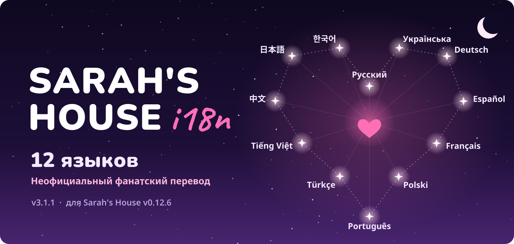

<p align="center">
  
</p>

<p align="center">
  <a href="https://github.com/elofaster/sarahs-house-i18n/releases/latest"></a>
  &nbsp;
  <a href="https://discord.gg/FXsWMq9Rv7"></a>
</p>

<p align="center">
<a href="../../README.md">English</a> &nbsp;✦&nbsp; <b>Русский</b> &nbsp;✦&nbsp; <a href="README.uk.md">Українська</a> &nbsp;✦&nbsp; <a href="README.de.md">Deutsch</a> &nbsp;✦&nbsp; <a href="README.es.md">Español</a> &nbsp;✦&nbsp; <a href="README.fr.md">Français</a> &nbsp;✦&nbsp; <a href="README.pl.md">Polski</a> &nbsp;✦&nbsp; <a href="README.pt.md">Português</a> &nbsp;✦&nbsp; <a href="README.tr.md">Türkçe</a> &nbsp;✦&nbsp; <a href="README.vi.md">Tiếng&nbsp;Việt</a> &nbsp;✦&nbsp; <a href="README.zh.md">中⁠文</a> &nbsp;✦&nbsp; <a href="README.ja.md">日⁠本⁠語</a> &nbsp;✦&nbsp; <a href="README.ko.md">한⁠국⁠어</a>
</p>

<br>


<p align="center"><sub>Игры в архиве нет. Нужна своя копия. <a href="https://store.steampowered.com/app/4712060/Sarahs_House" title="Купить в Steam">Steam</a> · <a href="https://ace-stud.itch.io/sarahs-house" title="Забрать на itch.io">itch.io</a></sub></p>

## ✦ Установка

1. Скачайте `SarahsHouse-i18n-v3.1.1.zip` со [страницы релизов](https://github.com/elofaster/sarahs-house-i18n/releases/latest).
2. Распакуйте архив в папку игры, туда, где лежит `SarahsHouse.exe`. Именно слить, а не вложить: папки из архива встают рядом с exe.
3. Запустите игру. Первый запуск идёт на минуту-две дольше: BepInEx один раз настраивается под вашу копию. Потом меню выбора языка откроется само.

В итоге папка выглядит так:

```text
SarahsHouse/
├─ SarahsHouse.exe
├─ winhttp.dll
├─ doorstop_config.ini
├─ dotnet/
└─ BepInEx/
    └─ plugins/
        └─ SarahsHouseI18n/
```

`winhttp.dll`, `doorstop_config.ini`, `dotnet/` и `BepInEx/` берутся из архива, сам мод это последняя папка.

<details>
<summary><b>Уже стоит BepInEx 6 IL2CPP?</b></summary>

Тогда нужен только мод: скопируйте `BepInEx/plugins/SarahsHouseI18n/` из архива в свою папку `BepInEx/plugins/` и запускайте игру. Остальное из архива не нужно, а выбранный язык запоминается для каждой установки.

</details>

<details>
<summary><b>Сменить язык позже</b></summary>

Нажмите <kbd>F10</kbd> в главном меню. Пикер открывается поверх сцены, текущий язык стоит в середине колеса, и после подтверждения текст меняется сразу.

</details>

## ✦ Выбор языка


Мышь, стрелки или геймпад. <kbd>Enter</kbd> подтверждает, <kbd>F10</kbd> открывает пикер снова.

## ✦ Если что-то пошло не так

<details>
<summary><b>Первый запуск тянется очень долго</b></summary>

Так и должно быть. BepInEx при первом запуске собирает сборки под вашу копию игры, минута-две, один раз. Все следующие запуски идут с обычной скоростью.
</details>

<details>
<summary><b>Антивирус ругается на <code>winhttp.dll</code></b></summary>

Это загрузчик BepInEx, он стандартный для модов на Unity. Верните файл из карантина и добавьте папку игры в исключения.
</details>

<details>
<summary><b>После обновления игры часть строк снова на английском</b></summary>

Новые и изменённые строки ещё не переведены, поэтому показываются на английском, а игра работает как обычно. Следующий релиз мода это закроет.
</details>

<details>
<summary><b>Как убрать мод?</b></summary>

Удалите `BepInEx/plugins/SarahsHouseI18n`. Если убрать и BepInEx, удалите ещё `winhttp.dll`, `doorstop_config.ini` и `dotnet/`. Игра вернётся к исходному виду.
</details>

---

<p align="center"><sub>
v3.1.1 · Sarah's House v0.12.6 · <a href="https://github.com/BepInEx/BepInEx">BepInEx</a> 6 IL2CPP<br>
Шрифты поставляются по лицензиям SIL OFL и Apache 2.0. Работает на BepInEx. Неофициальный фанатский перевод, к AceStudio отношения не имеет.
</sub></p>
