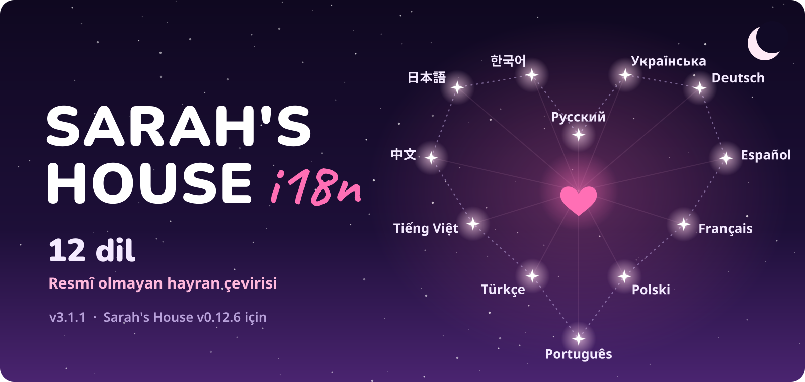

<p align="center">
  
</p>

<p align="center">
  <a href="https://github.com/elofaster/sarahs-house-i18n/releases/latest"></a>
  &nbsp;
  <a href="https://discord.gg/FXsWMq9Rv7"></a>
</p>

<p align="center">
<a href="../../README.md">English</a> &nbsp;✦&nbsp; <a href="README.ru.md">Русский</a> &nbsp;✦&nbsp; <a href="README.uk.md">Українська</a> &nbsp;✦&nbsp; <a href="README.de.md">Deutsch</a> &nbsp;✦&nbsp; <a href="README.es.md">Español</a> &nbsp;✦&nbsp; <a href="README.fr.md">Français</a> &nbsp;✦&nbsp; <a href="README.pl.md">Polski</a> &nbsp;✦&nbsp; <a href="README.pt.md">Português</a> &nbsp;✦&nbsp; <b>Türkçe</b> &nbsp;✦&nbsp; <a href="README.vi.md">Tiếng&nbsp;Việt</a> &nbsp;✦&nbsp; <a href="README.zh.md">中⁠文</a> &nbsp;✦&nbsp; <a href="README.ja.md">日⁠本⁠語</a> &nbsp;✦&nbsp; <a href="README.ko.md">한⁠국⁠어</a>
</p>

<br>


<p align="center"><sub>Oyun dahil değil. Kendi kopyana ihtiyacın var. <a href="https://store.steampowered.com/app/4712060/Sarahs_House" title="Steam'den al">Steam</a> · <a href="https://ace-stud.itch.io/sarahs-house" title="itch.io'dan al">itch.io</a></sub></p>

## ✦ Kurulum

1. `SarahsHouse-i18n-v3.1.1.zip` dosyasını [sürümler sayfasından](https://github.com/elofaster/sarahs-house-i18n/releases/latest) indir.
2. Arşivi `SarahsHouse.exe` dosyasının bulunduğu oyun klasörüne çıkar. Birleştir, iç içe koyma: arşivdeki klasörler exe'nin yanına gelir.
3. Oyunu başlat. İlk açılış bir iki dakika daha uzun sürer, BepInEx senin kopyan için bir kez kurulur, sonra dil seçici kendiliğinden açılır.

Sonrasında klasör şöyle görünür:

```text
SarahsHouse/
├─ SarahsHouse.exe
├─ winhttp.dll
├─ doorstop_config.ini
├─ dotnet/
└─ BepInEx/
    └─ plugins/
        └─ SarahsHouseI18n/
```

`winhttp.dll`, `doorstop_config.ini`, `dotnet/` ve `BepInEx/` arşivden gelir; modun kendisi son klasördür.

<details>
<summary><b>BepInEx 6 IL2CPP zaten kurulu mu?</b></summary>

O zaman sadece moda ihtiyacın var: arşivdeki `BepInEx/plugins/SarahsHouseI18n/` klasörünü kendi `BepInEx/plugins/` klasörüne kopyala ve oyunu başlat. Arşivden başka bir şey gerekmez, seçtiğin dil her kurulumda hatırlanır.

</details>

<details>
<summary><b>Dili sonradan değiştirme</b></summary>

Ana menüde <kbd>F10</kbd> tuşuna bas. Seçici sahnenin üzerinde açılır, mevcut dil çemberin ortasındadır ve onaylayınca metin hemen değişir.

</details>

## ✦ Dil seçici


Fare, yön tuşları veya gamepad. <kbd>Enter</kbd> onaylar, <kbd>F10</kbd> seçiciyi sonra geri getirir.

## ✦ Bir şeyler ters gittiyse

<details>
<summary><b>İlk açılış bitmek bilmiyor</b></summary>

Bu normal. BepInEx ilk çalıştırmada oyununun kopyası için assembly üretir, bir iki dakika, tek seferlik. Sonraki açılışlar normal hızda.
</details>

<details>
<summary><b>Antivirüsüm <code>winhttp.dll</code> dosyasını işaretliyor</b></summary>

Bu dosya BepInEx yükleyicisidir ve Unity modlarında standarttır. Karantinadan geri yükle ve oyun klasörünü istisnalara ekle.
</details>

<details>
<summary><b>Oyun güncellendikten sonra bazı satırlar İngilizceye döndü</b></summary>

Yeni ve değişen satırlar henüz çevrilmedi, İngilizce görünür ve oyun normal çalışır. Sonraki mod sürümü bu açığı kapatır.
</details>

<details>
<summary><b>Modu nasıl kaldırırım?</b></summary>

`BepInEx/plugins/SarahsHouseI18n` klasörünü sil. BepInEx'i de kaldırmak istersen `winhttp.dll`, `doorstop_config.ini` ve `dotnet/` dosyalarını da sil. Oyun çıktığı hâline döner.
</details>

---

<p align="center"><sub>
v3.1.1 · Sarah's House v0.12.6 · <a href="https://github.com/BepInEx/BepInEx">BepInEx</a> 6 IL2CPP<br>
Yazı tipleri SIL OFL ve Apache 2.0 kapsamında gelir. BepInEx üzerinde çalışır. Resmî olmayan hayran çevirisi, AceStudio ile bağlantılı değildir.
</sub></p>
