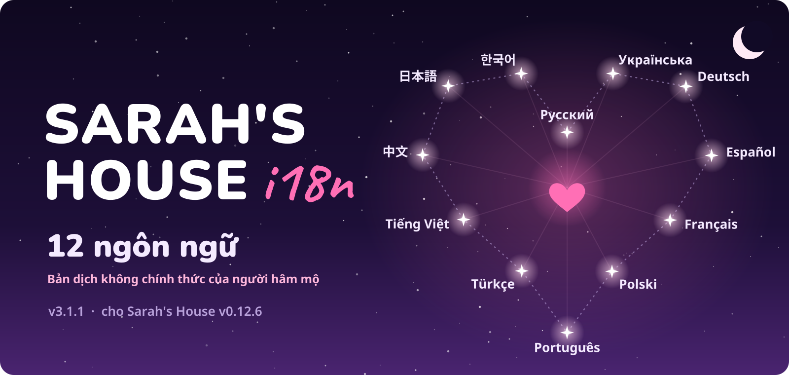

<p align="center">
  
</p>

<p align="center">
  <a href="https://github.com/elofaster/sarahs-house-i18n/releases/latest"></a>
  &nbsp;
  <a href="https://discord.gg/FXsWMq9Rv7"></a>
</p>

<p align="center">
<a href="../../README.md">English</a> &nbsp;✦&nbsp; <a href="README.ru.md">Русский</a> &nbsp;✦&nbsp; <a href="README.uk.md">Українська</a> &nbsp;✦&nbsp; <a href="README.de.md">Deutsch</a> &nbsp;✦&nbsp; <a href="README.es.md">Español</a> &nbsp;✦&nbsp; <a href="README.fr.md">Français</a> &nbsp;✦&nbsp; <a href="README.pl.md">Polski</a> &nbsp;✦&nbsp; <a href="README.pt.md">Português</a> &nbsp;✦&nbsp; <a href="README.tr.md">Türkçe</a> &nbsp;✦&nbsp; <b>Tiếng&nbsp;Việt</b> &nbsp;✦&nbsp; <a href="README.zh.md">中⁠文</a> &nbsp;✦&nbsp; <a href="README.ja.md">日⁠本⁠語</a> &nbsp;✦&nbsp; <a href="README.ko.md">한⁠국⁠어</a>
</p>

<br>


<p align="center"><sub>Bản mod không kèm game. Bạn cần bản game của riêng mình. <a href="https://store.steampowered.com/app/4712060/Sarahs_House" title="Mua trên Steam">Steam</a> · <a href="https://ace-stud.itch.io/sarahs-house" title="Tải trên itch.io">itch.io</a></sub></p>

## ✦ Cài đặt

1. Tải `SarahsHouse-i18n-v3.1.1.zip` ở [trang phát hành](https://github.com/elofaster/sarahs-house-i18n/releases/latest).
2. Giải nén vào thư mục game, thư mục có tệp `SarahsHouse.exe`. Gộp vào, đừng lồng thêm thư mục: các thư mục trong tệp nén nằm ngay cạnh exe.
3. Mở game. Lần chạy đầu lâu hơn một hai phút vì BepInEx tự cài cho bản game của bạn một lần, sau đó bảng chọn ngôn ngữ tự mở.

Sau đó thư mục sẽ như thế này:

```text
SarahsHouse/
├─ SarahsHouse.exe
├─ winhttp.dll
├─ doorstop_config.ini
├─ dotnet/
└─ BepInEx/
    └─ plugins/
        └─ SarahsHouseI18n/
```

`winhttp.dll`, `doorstop_config.ini`, `dotnet/` và `BepInEx/` đều lấy từ tệp nén; bản mod là thư mục cuối.

<details>
<summary><b>Đã có sẵn BepInEx 6 IL2CPP?</b></summary>

Vậy bạn chỉ cần bản mod: chép `BepInEx/plugins/SarahsHouseI18n/` từ tệp nén vào `BepInEx/plugins/` của bạn rồi mở game. Không cần gì khác trong tệp nén, và ngôn ngữ bạn chọn được nhớ cho từng bản cài.

</details>

<details>
<summary><b>Đổi ngôn ngữ về sau</b></summary>

Nhấn <kbd>F10</kbd> ở menu chính. Bảng chọn mở trên cảnh, ngôn ngữ hiện tại nằm giữa vòng xoay, và khi xác nhận thì văn bản đổi ngay.

</details>

## ✦ Bảng chọn ngôn ngữ


Chuột, phím mũi tên hoặc tay cầm. <kbd>Enter</kbd> xác nhận, <kbd>F10</kbd> mở lại bảng chọn về sau.

## ✦ Nếu có gì đó không ổn

<details>
<summary><b>Lần chạy đầu lâu như không bao giờ xong</b></summary>

Đây là bình thường. Lần đầu BepInEx tạo assembly cho bản game của bạn, một hai phút, chỉ một lần. Những lần sau chạy với tốc độ bình thường.
</details>

<details>
<summary><b>Trình diệt virus báo <code>winhttp.dll</code></b></summary>

Tệp đó là bộ nạp BepInEx, chuẩn với mọi bản mod Unity. Khôi phục nó khỏi vùng cách ly và thêm thư mục game vào danh sách loại trừ.
</details>

<details>
<summary><b>Sau khi game cập nhật, vài dòng quay lại tiếng Anh</b></summary>

Các dòng mới và dòng đã đổi chưa được dịch nên hiển thị bằng tiếng Anh, game vẫn chạy bình thường. Bản mod tiếp theo sẽ lấp chỗ trống.
</details>

<details>
<summary><b>Làm sao gỡ bản mod?</b></summary>

Xóa thư mục `BepInEx/plugins/SarahsHouseI18n`. Nếu muốn gỡ cả BepInEx thì xóa thêm `winhttp.dll`, `doorstop_config.ini` và `dotnet/`. Game trở về như ban đầu.
</details>

---

<p align="center"><sub>
v3.1.1 · Sarah's House v0.12.6 · <a href="https://github.com/BepInEx/BepInEx">BepInEx</a> 6 IL2CPP<br>
Phông chữ đi kèm theo giấy phép SIL OFL và Apache 2.0. Chạy trên BepInEx. Bản dịch của người hâm mộ, không liên quan tới AceStudio.
</sub></p>
